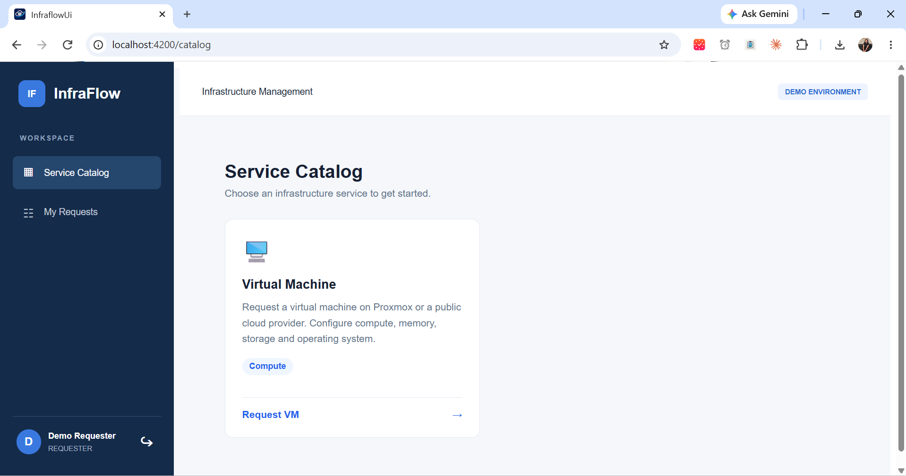
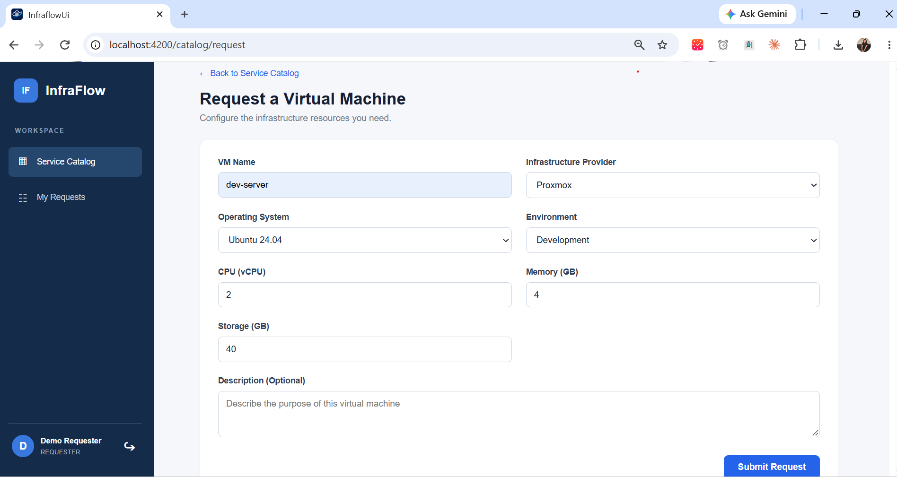
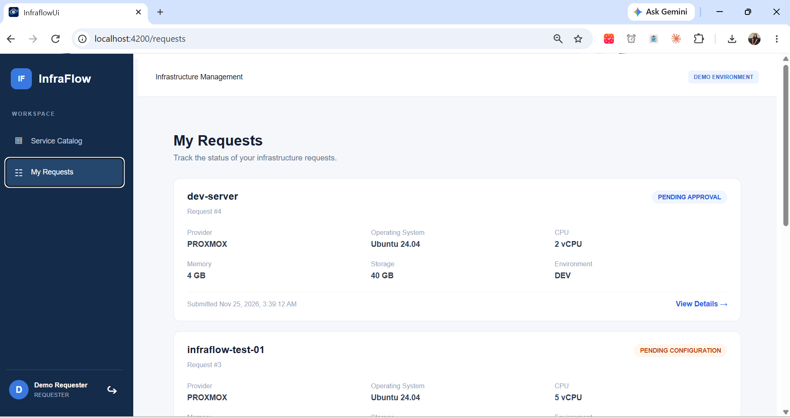
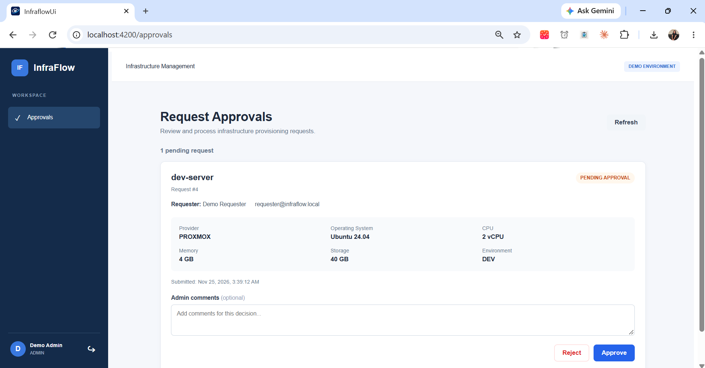
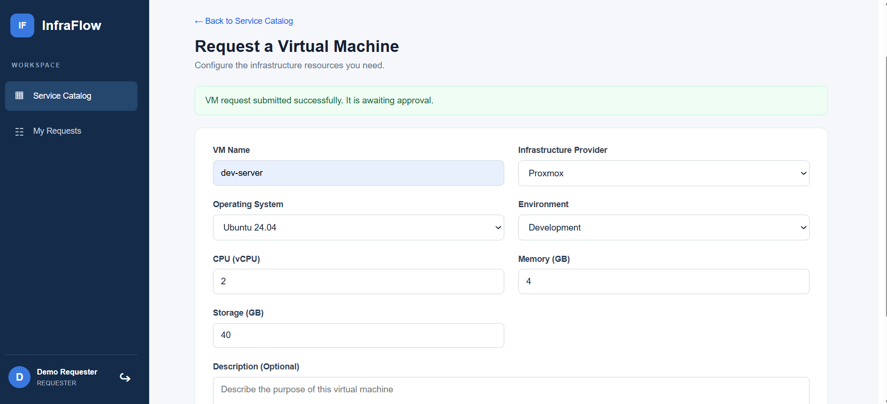
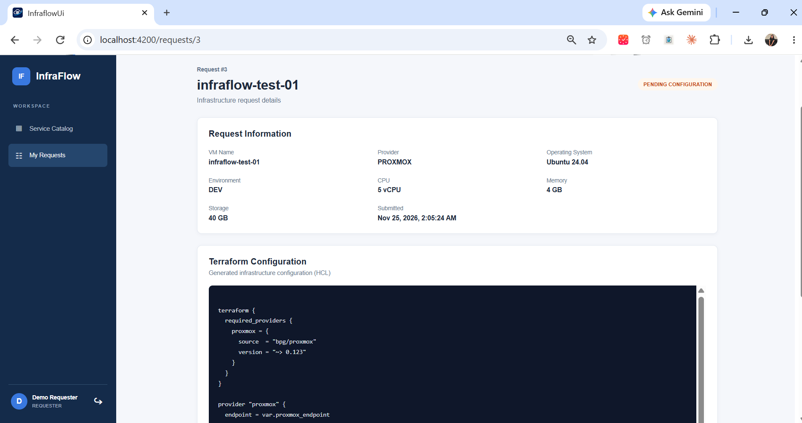

# InfraFlow – Demo Guide

## 1. Introduction

InfraFlow is a proof-of-concept infrastructure self-service portal that demonstrates VM request submission, resource quota validation, administrative approvals, request tracking and Terraform configuration generation.

This guide walks through the implemented application workflows.

## 2. Demo Environment

Start the following services before beginning:

- PostgreSQL database
- RabbitMQ message broker
- Backend API
- Provisioning worker
- Angular frontend

Refer to [SETUP.md](SETUP.md) for installation and startup instructions.

Open the application:

`http://localhost:4200`

## 3. Authentication and User Roles

InfraFlow provides two demo roles:

| Account | Role | Permissions |
|---|---|---|
| requester@infraflow.local | REQUESTER | Submit and view own infrastructure requests |
| admin@infraflow.local | ADMIN | View requests and approve or reject pending requests |

Use the demo authentication flow to sign in.

## 4. Requester Workflow

### Step 1: Sign in

Sign in using the requester demo account.

The requester is directed to the infrastructure service catalog.

### Step 2: Browse the Service Catalog

Open the service catalog and select the available VM service.

The catalog provides access to the VM request form.

### Step 3: Submit a VM Request

Enter the requested infrastructure configuration:

- VM name
- Infrastructure provider
- Operating system
- CPU allocation
- Memory allocation
- Storage allocation
- Environment
- Description

Submit the form.

The backend validates the request and checks the user's resource quota before saving it.

### Step 4: View My Requests

Navigate to **My Requests**.

The requester can view submitted infrastructure requests, including:

- Request ID
- VM name
- Provider
- CPU, memory and storage
- Environment
- Submission date
- Current request status

### Step 5: View Request Details

Select **View Details** on a request.

The details page displays the submitted configuration and the current request status.

For requests with generated Terraform configuration, the HCL is displayed on the same page.

If a request is still awaiting approval or has been rejected, its Terraform configuration may not be available.

## 5. Administrator Workflow

### Step 1: Sign in as Administrator

Sign out of the requester account and sign in using the administrator demo account.

Navigate to **Approvals**.

### Step 2: Review Pending Requests

The administrator can inspect pending requests, including requester information and requested resource allocation.

### Step 3: Approve or Reject a Request

The administrator can:

- Approve a pending request.
- Reject a pending request.
- Add optional comments when making a decision.

The backend processes the decision and updates the request status.

### Step 4: Verify the Request Status

After the decision, return to the requester account and open **My Requests**.

The updated status is visible to the requester.

## 6. Terraform Configuration

When an administrator approves a request, the backend generates Terraform HCL for the selected provider and stores it with the request.

The requester or authorized administrator can open the request details page to view the generated configuration.

This demonstrates the infrastructure-as-code generation workflow.

## 7. Provisioning Workflow

The application uses RabbitMQ to queue provisioning jobs.

The backend publishes jobs for processing by the provisioning worker.

The worker contains integrations for:

- **GitLab CI:** Trigger pipeline execution.
- **AWX:** Launch automation job templates.
- **Terraform:** Generate provider-specific infrastructure configuration.

Actual external pipeline execution, AWX job execution and infrastructure deployment require valid external service configuration and credentials.

The current POC does not implement complete external job status polling or infrastructure lifecycle reconciliation.

## 8. Features Demonstrated

| Feature | Demonstration |
|---|---|
| Authentication | Demo requester and administrator login |
| Service Catalog | Browse available VM service |
| VM Requests | Submit infrastructure requests |
| Quota Validation | Validate requested CPU, RAM and disk |
| RBAC | Restrict access based on user role |
| Approvals | Approve or reject requests |
| Request Tracking | View request status |
| Request Details | Inspect submitted VM configuration |
| Terraform | View generated HCL |
| Provisioning Queue | RabbitMQ-based job processing |
| Automation Integrations | GitLab CI and AWX integration code |

## 9. POC Scope and Limitations

InfraFlow demonstrates the core application workflows and integration points required for an infrastructure self-service portal.

The following capabilities require additional environment configuration or implementation before production use:

- Live Proxmox and public cloud provisioning.
- Production SAML and LDAP identity-provider configuration.
- Configured GitLab CI and AWX environments.
- Complete external job status polling and infrastructure lifecycle management.

The demo focuses on the implemented application workflows rather than claiming a fully operational production provisioning platform.

## Application Screenshots

### 1. Service Catalog

### 2. VM Request Form

### 3. My Requests

### 4. Admin Approvals

### 5. Request Details

### 6. Terraform Configuration

